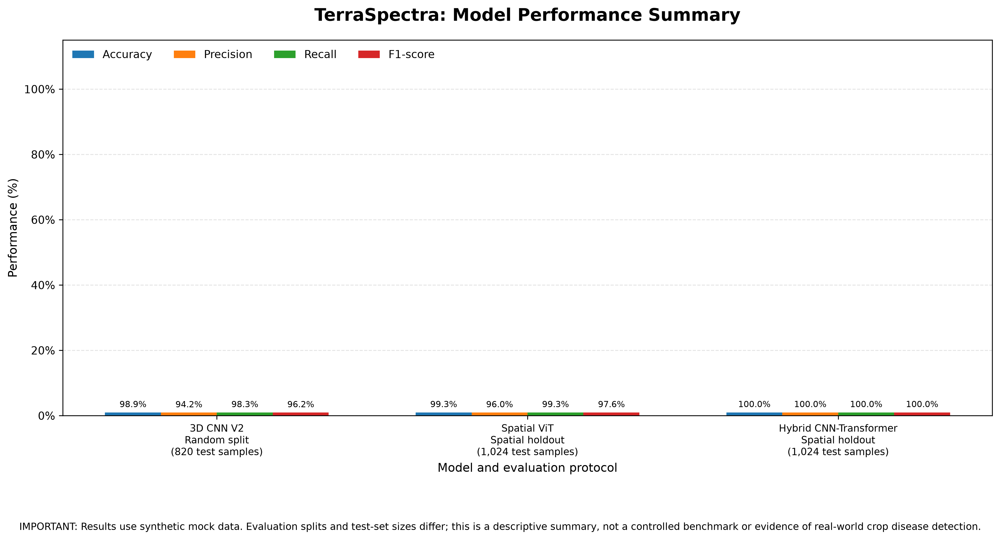

# TerraSpectra: Hyperspectral Crop Disease Forecasting

## 1. Project Overview

TerraSpectra is a Data Science and Machine Learning project focused on hyperspectral crop imagery analysis for identifying crop stress patterns and supporting crop health assessment.

The project develops an end-to-end workflow involving hyperspectral data loading, preprocessing, spectral analysis, dimensionality reduction, deep learning, model evaluation, and geospatial visualization.

**Important:** The current experiments use clearly labelled synthetic hyperspectral data. Results demonstrate pipeline functionality and do not establish real-world crop disease detection performance.

## 2. Project Objectives

- Process hyperspectral imagery containing multiple spectral bands.
- Analyze spectral and spatial characteristics of crop data.
- Perform data validation, preprocessing, and exploratory analysis.
- Apply Principal Component Analysis (PCA) for dimensionality reduction.
- Develop a 3D Convolutional Neural Network (3D-CNN).
- Evaluate classification performance using appropriate metrics.
- Visualize crop stress patterns using a geospatial dashboard.
- Develop an API for future model inference.

## 3. Project Modules

1. Hyperspectral Data Loading
2. Data Validation and Preprocessing
3. Spectral Analysis and PCA
4. 3D-CNN Model Development
5. Hybrid CNN-Transformer Model Development
6. Model Training and Evaluation
7. Spatial and Spectral Analysis
8. Grad-CAM Explainability
9. Geospatial Visualization Dashboard
10. Future FastAPI Inference Backend

## 4. Technology Stack

| Component | Technology |
|---|---|
| Programming | Python 3.11 |
| Data Processing | NumPy, Pandas, SciPy |
| Geospatial Processing | Rasterio |
| Machine Learning | Scikit-learn |
| Deep Learning | PyTorch |
| Visualization | Matplotlib, Seaborn, Plotly |
| Frontend | React |
| Geospatial Visualization | Deck.gl |
| Version Control | Git, GitHub |

## 5. Project Structure

```text
TerraSpectra/
├── backend/
├── data/
│   ├── raw/
│   ├── processed/
│   └── sample/
├── docs/
├── frontend/
├── models/
├── notebooks/
├── reports/
│   └── hybrid_explainability/
├── src/
│   ├── preprocessing/
│   ├── models/
│   ├── training/
│   ├── inference/
│   └── evaluation/
├── tests/
├── .gitignore
├── README.md
└── requirements.txt
```

## 6. Development Methodology

The project follows these stages:

1. Requirement analysis and dataset identification.
2. Hyperspectral data loading and validation.
3. Data preprocessing and normalization.
4. Exploratory data analysis and spectral analysis.
5. PCA-based dimensionality reduction.
6. 3D-CNN architecture development.
7. Hybrid CNN-Transformer architecture development.
8. Model training using training data.
9. Validation-based threshold selection.
10. Spatial model evaluation.
11. Grad-CAM explainability analysis.
12. Dashboard development and documentation.

## 7. Current Implementation

### Hyperspectral Data

- Synthetic hyperspectral GeoTIFF sample.
- 200 spectral bands.
- Image dimensions: 64 × 64 pixels.
- Total pixels: 4,096.
- Healthy samples: 3,520.
- Stressed samples: 576.

### Dimensionality Reduction

PCA was applied to the synthetic hyperspectral dataset.

The first 30 principal components explain approximately 87.72% of the variance in the generated sample.

### Deep Learning Model

A 3D Convolutional Neural Network was implemented using PyTorch.

- Input: Hyperspectral spatial patches.
- Input dimensions per sample: 1 × 200 × 5 × 5.
- Classes: Healthy (0) and Stressed (1).
- Training device: CPU.
- Dataset split: 60% training, 20% validation, 20% testing.

### Final Test Results

| Metric | Result |
|---|---:|
| Accuracy | 98.90% |
| Precision | 94.17% |
| Recall | 98.26% |
| F1-score | 96.17% |

Confusion matrix:

```text
[[698   7]
 [  2 113]]
```

The classification threshold was selected using validation data and then applied to the reserved test split.

**Evaluation limitation:** These results are from a synthetic dataset and a random pixel split. Neighbouring spatial patches may overlap between partitions. Therefore, these metrics should not be interpreted as independent spatial validation or real-world crop disease performance.

## 8. Installation and Setup

### Clone the Repository

```powershell
git clone https://github.com/nooremujassim-ux/TerraSpectra.git
cd TerraSpectra
```

### Create a Virtual Environment

Windows PowerShell:

```powershell
python -m venv .venv
.venv\Scripts\Activate.ps1
```

### Install Dependencies

```powershell
python -m pip install --upgrade pip
pip install -r requirements.txt
```

For a CPU-only PyTorch installation, use the official CPU wheel index if needed:

```powershell
python -m pip install torch --index-url https://download.pytorch.org/whl/cpu
```

## 9. Running the Project

### Run the Test Suite

```powershell
python -m pytest -q
```

### Train the 3D-CNN

```powershell
python -m src.training.train_cnn
```

### Analyze the Validation Threshold

```powershell
python -m src.training.threshold_analysis
```

### Evaluate the Reserved Test Dataset

```powershell
python -m src.training.evaluate_cnn
```

### Run the Frontend

```powershell
cd frontend
npm install
npm run dev
```

## 10. Evaluation Metrics

The project uses:

- Accuracy
- Precision
- Recall
- F1-score
- Confusion Matrix

Additional spatial and spectral evaluation experiments are included in the training and evaluation modules.

## 11. Research and Validation Policy

Synthetic data is used for pipeline development and testing. It is not presented as genuine agricultural observation data.

Real-world crop stress or disease detection claims require suitable field-collected or independently sourced hyperspectral datasets, reliable ground-truth labels, and spatially independent validation.

## 12. Internship Information

**Organization:** Infotact Solutions

**Project:** TerraSpectra: Hyperspectral Crop Disease Forecasting

**Project Start Date:** 10 November 2026

**Project Deadline:** 10 December 2026

## 13. Author

**Noor E Mujassim**

Data Science and Machine Learning Intern

## 14. Hybrid Model and Explainability

TerraSpectra includes a hybrid CNN-Transformer architecture for hyperspectral spatial-spectral classification.

### Hybrid CNN-Transformer Model

The hybrid model combines:

- 3D CNN layers for local spectral-spatial feature extraction.
- Transformer encoder layers for feature representation.
- A classification head for healthy and stressed pixel classification.

**Input dimensions:** 1 × 200 × 5 × 5

**Output classes:** Healthy (0) and Stressed (1)

### Spatial Training and Evaluation

The hybrid model uses spatially separated training and evaluation regions from the synthetic hyperspectral sample.

Run hybrid training:

```powershell
python -m src.training.train_hybrid
```

Run spatial evaluation:

```powershell
python -m src.training.evaluate_hybrid_spatial
```

### Hybrid Grad-CAM Explainability

A gradient-based explainability module was implemented to inspect the hybrid model's learned activations.

The implementation provides:

1. **3D Grad-CAM heatmap:** Spectral-spatial activation map across 200 bands and a 5 × 5 spatial patch.
2. **Spectral importance visualization:** Relative activation scores across individual spectral bands.
3. **Spatial Grad-CAM visualization:** Spatial activation patterns obtained by aggregating across spectral bands.
4. **Metadata report:** Records sample index, pixel location, actual class, predicted class, prediction confidence, and data limitations.

Generate explainability outputs:

```powershell
python -m src.evaluation.generate_hybrid_explanations
```

Generated files are saved in:

```text
reports/
└── hybrid_explainability/
    ├── hybrid_gradcam_3d.npy
    ├── sample_metadata.txt
    ├── spatial_gradcam.png
    ├── spectral_importance.csv
    └── spectral_importance.png
```

### Automated Testing

Dedicated tests validate:

- Grad-CAM output dimensions.
- Finite heatmap values.
- Heatmap normalization.
- Explicit target-class support.
- Removal of registered hooks.

The complete project test suite currently reports **39 passing tests**.

Run all tests:

```powershell
python -m pytest -v
```

### Explainability Limitations

Grad-CAM visualizations represent gradient-weighted model activations. Spectral activation scores are not causal feature importance measurements.

The current experiments use synthetic mock hyperspectral data. These visualizations do not establish real-world crop disease detection performance or agricultural reliability.
## 15. Model Performance Comparison

TerraSpectra evaluates three deep learning models for hyperspectral
crop stress classification.

### Performance Visualization



### Evaluation Summary

| Model | Evaluation Protocol | Accuracy | Precision | Recall | F1-score |
|---|---|---:|---:|---:|---:|
| 3D CNN V2 | Random split | 98.90% | 94.17% | 98.26% | 96.17% |
| Spatial ViT | Spatial holdout | 99.32% | 95.97% | 99.31% | 97.61% |
| Hybrid CNN-Transformer | Spatial holdout | 100.00% | 100.00% | 100.00% | 100.00% |

**Important limitations:**

- Experiments use synthetic mock hyperspectral data.
- The CNN uses a random split, whereas Spatial ViT and Hybrid use spatial holdouts.
- Test-set sizes and evaluation protocols differ.
- These results are descriptive, not a controlled head-to-head benchmark.
- The results do not establish real-world crop disease detection performance.

## 16. Detailed Model Evaluation and Scientific Validation

For complete model configurations, confusion matrices, evaluation protocols, spatial split methodology, historical experiments, scientific limitations, and recommended future validation, see the [Model Evaluation and Scientific Validation Report](reports/model_comparison.md).
